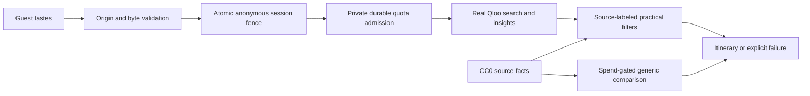

# Taste Concierge

An Athens concierge for boutique hotels and small travel businesses. Guests supply cultural tastes and preferences; genuine Qloo results carry explicitly sourced city, category and coordinate facts. Independently bound venues retain independent evidence; genuinely unbound venues can use fields Qloo actually reports.

Hosted development demo: https://taste-concierge-athens.vercel.app. Evaluated application code: `305ff5b`. Nine of ten frozen profiles produced both categories, with all 36 displayed venues linked to real captured Qloo responses; the tenth needs a venue choice. Three cross-domain API journeys and five preference dependency updates passed. Nineteen constraint replay cases passed; source-field expiry remains unsupported (C16 blocked). Five controlled server outage cases passed. These results do not establish recommendation quality or a completed submission.

Generic model comparison and free-text preference interpretation remain unavailable while model access is disabled. Dependency refresh may preserve the same Qloo ranking. Provider numeric quotas and other prior provider usage remain unknown. Hosted admission uses a finite application allowance without claiming those limits are known. Missing allowance, credential or binding configuration returns unavailable.

Tests distinguish synthetic provider behavior, actual PostgreSQL persistence and genuine external acceptance. A passing offline suite or database canary does not establish a successful Qloo itinerary or model comparison. Paid live inference remains disabled.

## Local development

Use Node 24 and npm. Packages and the lockfile are pinned. The deployment runtime is Node 24; local Node 24.21.0 is available for verification.

```sh
npm ci
npm run dev -- --port 3100
npm run typecheck
npm test
npm run build
npm run test:browser
npm run evaluate
```

Copy `.env.example` to ignored `.env.local` for approved local configuration. `RUNTIME_STORAGE=filesystem` supports one local Node process with private file credentials and evidence. Missing Qloo policy, ledger, credential or evidence configuration denies upstream traffic. `APP_ORIGIN` must exactly match the browser origin. Production has no origin or storage default.

## Vercel deployment

Hosted instances use `RUNTIME_STORAGE=postgres`, a restricted runtime-role `DATABASE_URL`, and the exact HTTPS `APP_ORIGIN`. PostgreSQL coordinates session expiry, revision fences, request leases, provider admission and private evidence. Vercel rejects the filesystem mode. Long operations have a 90-second application deadline and a 100-second function limit. Region `fra1` is configured alongside the Frankfurt database.

Use a separate migration credential locally to apply `migrations/001-runtime.sql` through `scripts/migrate-runtime.ts`, then `migrations/002-provider.sql` through `scripts/import-runtime.ts`. Apply additive `003-application-allowance.sql` before V2 admission and `004-session-envelope-v2.sql` before deploying source-labeled session envelopes. The latter preserves old v1 sessions while permitting v2; no state/counter reset. Migrations never run at startup or build. Bindings are imported explicitly with `--bindings` and a private `PRIVATE_EVIDENCE_DIR`; original capture integrity and approved membership are checked. Importing evidence does not initialize a provider allowance. Neither scripts nor runtime invent unknown provider limits or prior usage.

Only the restricted role belongs in Production and Preview. Keep database-owner credentials and all credential aliases out of those environments. Preview has no Qloo key; live provider traffic stays closed there. A preview origin must be configured explicitly before interactive testing. Production uses a public stable domain; deployment URLs and previews retain Vercel Authentication.

The session migration creates `taste_runtime_app` as `NOLOGIN`. An operator must separately enable login with a newly generated private password and construct its connection URL using the database host, database name and SSL settings from the dedicated resource. Verify `current_user` is `taste_runtime_app` and direct private-table access fails before setting the runtime URL. Never deploy the migration owner's URL. The migration revokes public temporary-table privileges on this dedicated database, so do not target an unrelated shared database.

Application-allowance mode applies only to the event API. It records unknown provider quotas/usage explicitly, binds the issued key privately, and counts every durable application attempt against one shared lifetime cap. The selected demo cap is300 recorded attempts (12 earlier diagnostics plus at most288 additional), with a local cutoff at judging end, November17,2026,04:45UTC. This is finite shared demo capacity, not a Qloo quota or a guarantee of availability. There is no automatic refill, rollover, retry or paid fallback. A new deployment or credential cannot reset consumption. No-disclosed-fee event use is inferred from event access, issued mail and Qloo's advance-fee-disclosure terms; a disclosed applicable charge closes admission under the$0 spending ceiling.

One-time V2 initialization uses `scripts/initialize-allowance.ts` with the operator `DATABASE_URL` and an absolute private policy-file path as its first argument. The file must be0600 inside a0700 directory outside this repository. Its fields follow `ApplicationPolicy` in `src/server/admission/application-policy.ts`; category tags/origin and bindings require genuine retained evidence, and the credential digest must be computed privately from the issued key. Initialization succeeds only for a missing policy with no active or uncertain work. It preserves all history and halt state; rerunning cannot refill or overwrite it. Runtime credentials cannot perform this initialization.

Real persistence tests require explicit test configuration, private operator/runtime credentials, and an unused test database. Never point fixture-control tests at an active guest database. Ordinary `npm test` does not prove database acceptance when those tests are skipped. Private captured provider data and bindings stay outside public source and browser assets.

## Data and limitations

The independent pool contains 39 CC0 Wikidata records: four dining and thirty-five attractions. Added museum records retain direct or verified subclass museum classification, city membership and coordinate provenance; retained class evidence records actual subclass links. One original conflicting coordinate stays unknown. Genuinely unbound candidates can use validated Qloo-reported city/category/coordinates, labeled not independently verified. Failed, ambiguous or conflicting independent bindings cannot use that fallback. Qloo facts have actual retrieval time, no invented revision or CC0 license. Classification and city membership are source-reported metadata, not proof of current operation or municipal boundaries. Category filters cover restaurants and museums. Distances are straight-line from the documented Athens reference point, not walking routes.

Budget and opening-time requirements return unsupported. No booking, availability, accessibility, allergy or dietary-safety assurance. Raw Qloo responses, returned identifiers, scores and private identity bindings are excluded from public source and assets.

The local model adapter uses a pinned OpenAI Responses model, strict arm-specific option whitelists and durable spend admission. It requires separately authorized API access and a concrete spend ceiling. Default spend is zero. The hosted model adapter remains disabled until free inference access and its financial boundary are verified. Unavailable inference cannot be represented as a successful comparison.

Comparison evaluates whole systems on the same ten briefs, model/settings, constraints and rubric. Generic AI gets the39independent fixtures. Treatment additionally gets Qloo candidates, ordinal and reported location/category, plus independent facts where bound. Candidate/fact pools differ; this does not isolate affinity ranking or establish general superiority. No model outputs/human scores have been generated. See `evaluation/README.md` for prospective protocol and failure reporting.

## Architecture



Evaluation preflight reports missing evidence explicitly. `npm run evaluate` is an offline preparation check, separate from the dated actual observations in `evaluation/genuine-summary.json`. Retained real-response replay, controlled faults and live HTTP journeys are labeled separately. Paired model outputs, independent human ratings and the five complete anonymous browser/comparison journeys remain pending. No measured quality improvement is claimed.

## Licensing

Original application code: MIT. Independent Wikidata facts: CC0, with source URLs, revisions and dates retained. Ported UI control attribution: `src/ui/SOURCES.md`. No Qloo SDK or starter source copied. See `SOURCES.md` and `data/practical/SOURCES.md`.
