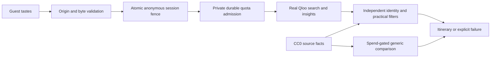

# Taste Concierge

An Athens concierge for boutique hotels and small travel businesses. Guests supply cultural tastes and preferences; genuine Qloo results are checked against an independent practical-source pool before presentation.

Private implementation. Qloo authentication, response shapes and three two-category coverage probes were verified separately. Those probes are preparation evidence, not successful application journeys. Current independent fixture bindings: **zero**. Provider numeric quota policy is unknown. Anonymous upstream admission therefore stays closed; the application shows an explicit unavailable state. No successful hackathon acceptance target is claimed.

Verification: 90 unit/integration-boundary checks pass, one paid live check is intentionally skipped; 15 browser checks pass, including explicitly synthetic states. Next production build/typecheck pass, independent code/security reviews approve the implemented boundaries, and the public-source/client export audit found zero credential/provider-ID leaks. Six actual local production smoke checks cover the unconfigured path, not successful Qloo journeys.

## Local development

Installed/pinned packages and a lockfile support reproducible builds. Tested local runtime is Node 25.8.1; an actual Node 22 release runtime remains to be verified.

```sh
npm ci
npm run dev -- --port 3100
npm run typecheck
npm test
npm run build
npm run test:browser
npm run evaluate
```

Copy `.env.example` to ignored `.env.local` for approved local configuration. Secrets are supplied by private file paths, never pasted into browser fields or public source. Missing Qloo policy, ledger, credential or private evidence configuration denies upstream traffic. `APP_ORIGIN` must exactly match the browser origin. Production has no origin default. One Node instance only; this in-memory session design cannot be deployed across replicas.

## Data and limitations

The independent pool contains 14 CC0 Wikidata records: four dining and ten attractions. One conflicting coordinate stays unknown. Classification and city membership are source-reported metadata, not proof of current operation or municipal boundaries. Qloo's first supported category filters cover restaurants and museums. Distances are straight-line distances from the documented Athens reference point, not walking routes.

Budget and opening-time requirements return unsupported. No booking, availability, accessibility, allergy or dietary-safety assurance. Raw Qloo responses, returned identifiers, scores and private identity bindings are excluded from public source and assets.

Generic model comparison and treatment interpretation are implemented with a pinned OpenAI Responses model, strict fixture whitelists and durable spend admission. They require separately authorized API access and a concrete spend ceiling. Default spend is zero. Unavailable inference cannot be represented as a successful comparison.

## Architecture



Evaluation preflight reports missing evidence explicitly. Synthetic geometry/fault/unit checks are separate from live acceptance. A hosted demo, real grounded journeys, human paired ratings and anonymous release checks remain pending.

## Licensing

Original application code: MIT. Independent Wikidata facts: CC0, with source URLs, revisions and dates retained. Ported UI control attribution: `src/ui/SOURCES.md`. No Qloo SDK or starter source copied. See `SOURCES.md` and `data/practical/SOURCES.md`.
