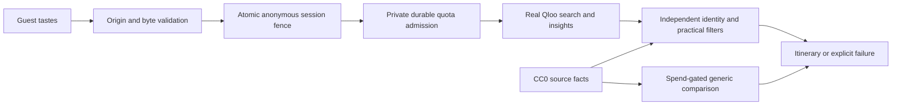

# Taste Concierge

An Athens concierge for boutique hotels and small travel businesses. Guests supply cultural tastes and preferences; genuine Qloo results are checked against an independent practical-source pool before presentation.

Development build. Qloo authentication, response shapes and three two-category coverage probes were verified separately. Those probes are preparation evidence, not successful application journeys. Private venue identity bindings remain incomplete. Provider numeric quota policy is unknown. Anonymous upstream admission therefore stays closed; the application shows an explicit unavailable state. No successful hackathon acceptance target is claimed.

Tests distinguish synthetic provider behavior, actual PostgreSQL persistence and genuine external acceptance. A passing offline suite or database canary does not establish a successful Qloo itinerary or model comparison. Paid live inference remains disabled.

## Local development

Use Node 24 and npm. Packages and the lockfile are pinned. The deployment runtime is Node 24; local Node 24.21.0 is available for verification.

```sh
npm ci
npm run dev -- --port 3100
npm run typecheck
npm test
npm run build
npm run test:browser
npm run evaluate
```

Copy `.env.example` to ignored `.env.local` for approved local configuration. `RUNTIME_STORAGE=filesystem` supports one local Node process with private file credentials and evidence. Missing Qloo policy, ledger, credential or evidence configuration denies upstream traffic. `APP_ORIGIN` must exactly match the browser origin. Production has no origin or storage default.

## Vercel deployment

Hosted instances use `RUNTIME_STORAGE=postgres`, a restricted runtime-role `DATABASE_URL`, and the exact HTTPS `APP_ORIGIN`. PostgreSQL coordinates session expiry, revision fences, request leases, provider admission and private evidence. Vercel rejects the filesystem mode. Long operations have a 90-second application deadline and a 100-second function limit. Region `fra1` is configured alongside the Frankfurt database.

Use a separate migration credential locally to apply `migrations/001-runtime.sql` through `scripts/migrate-runtime.ts`, then `migrations/002-provider.sql` through `scripts/import-runtime.ts`. These operator scripts never run at startup or build. Bindings are imported explicitly with `--bindings` and a private `PRIVATE_EVIDENCE_DIR`; original capture integrity and approved membership are checked. Importing evidence does not initialize a provider allowance. Neither scripts nor runtime invent unknown provider limits or prior usage.

Only the restricted role belongs in Production and Preview. Keep database-owner credentials and all credential aliases out of those environments. Preview has no Qloo key; live provider traffic stays closed there. A preview origin must be configured explicitly before interactive testing. Production uses a public stable domain; deployment URLs and previews retain Vercel Authentication.

Real persistence tests require explicit test configuration, private operator/runtime credentials, and an unused test database. Never point fixture-control tests at an active guest database. Ordinary `npm test` does not prove database acceptance when those tests are skipped. Private captured provider data and bindings stay outside public source and browser assets.

## Data and limitations

The independent pool contains 39 CC0 Wikidata records: four dining and thirty-five attractions. Added museum records retain direct or verified subclass museum classification, city membership and coordinate provenance; retained class evidence records the actual subclass links. One original conflicting coordinate stays unknown. Classification and city membership are source-reported metadata, not proof of current operation or municipal boundaries. Qloo's first supported category filters cover restaurants and museums. Distances are straight-line distances from the documented Athens reference point, not walking routes.

Budget and opening-time requirements return unsupported. No booking, availability, accessibility, allergy or dietary-safety assurance. Raw Qloo responses, returned identifiers, scores and private identity bindings are excluded from public source and assets.

The local model adapter uses a pinned OpenAI Responses model, strict fixture whitelists and durable spend admission. It requires separately authorized API access and a concrete spend ceiling. Default spend is zero. The hosted model adapter remains disabled until free inference access and its financial boundary are verified. Unavailable inference cannot be represented as a successful comparison.

## Architecture



Evaluation preflight reports missing evidence explicitly. Synthetic geometry/fault/unit checks are separate from live acceptance. A hosted demo, real grounded journeys, human paired ratings and anonymous release checks remain pending.

## Licensing

Original application code: MIT. Independent Wikidata facts: CC0, with source URLs, revisions and dates retained. Ported UI control attribution: `src/ui/SOURCES.md`. No Qloo SDK or starter source copied. See `SOURCES.md` and `data/practical/SOURCES.md`.
